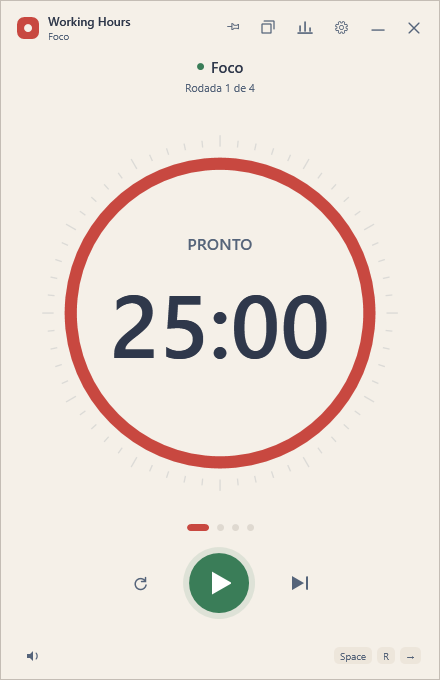
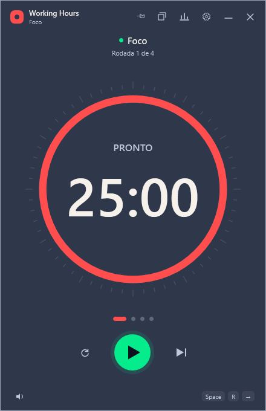
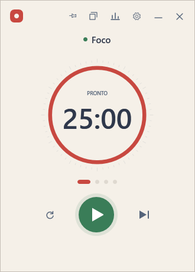
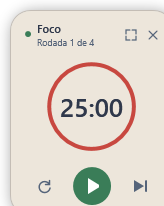
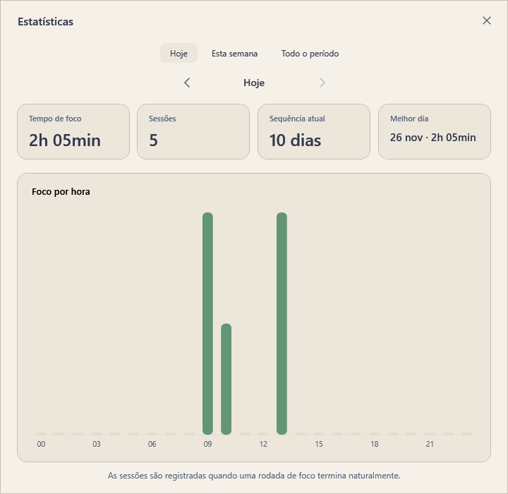
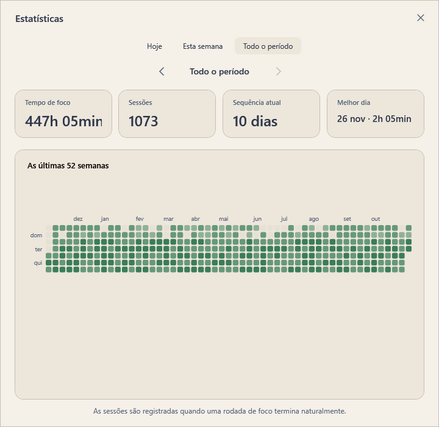
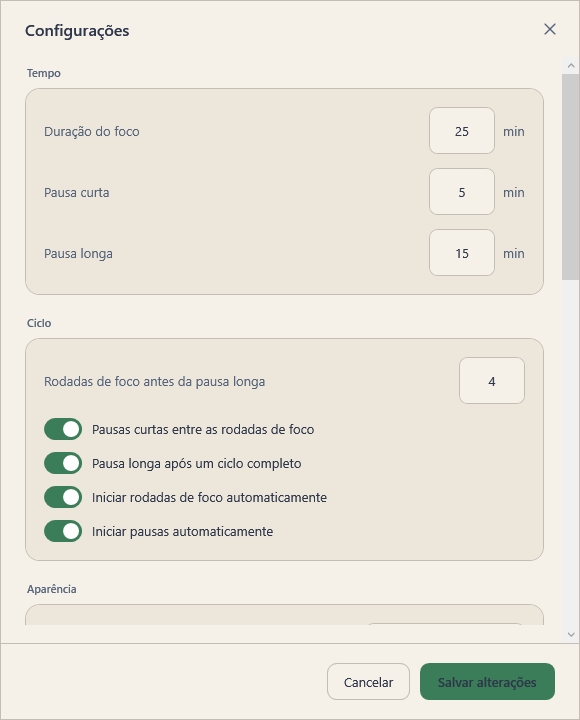
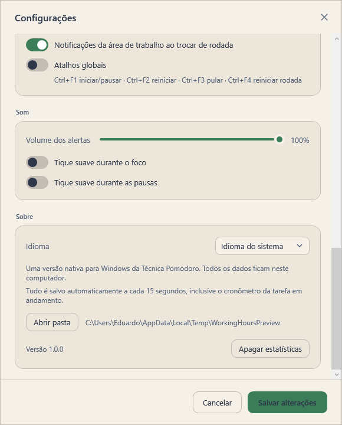

# Working Hours

Uma releitura nativa para Windows do [Pomotroid](https://github.com/Splode/pomotroid), escrita em **C# / WPF / .NET 10** — sem Electron, Tauri, Node ou WebView.



## Recursos

- **Timer Pomodoro configurável** — duração de foco, pausa curta e pausa longa; número de rodadas antes da pausa longa; pausas opcionais; início automático de foco/pausa.
- **Integração real com o Windows**
  - ícone na bandeja com **anel de progresso desenhado em tempo real** e menu de contexto;
  - minimizar/fechar para a bandeja;
  - **atalhos globais** via `RegisterHotKey`;
  - notificações nativas da área de trabalho;
  - progresso do timer na **barra de tarefas** (`TaskbarItemInfo`);
  - janela com cantos arredondados via DWM, DPI per-monitor e instância única.
- **38 temas embutidos** do Pomotroid (Dracula, Nord, Tokyo Night, Catppuccin, Gruvbox, Rose Pine, Solarized…).
- **Temas customizados** em JSON com *hot reload* — salve o arquivo e o app atualiza sem reiniciar.
- **Tema claro/escuro automático** seguindo a preferência do Windows.
- **Estatísticas** diária, semanal e de todo o período, com sequência atual, melhor dia e mapa de calor de 52 semanas.
- **Som gerado em memória** (sem arquivos externos): alertas de conclusão, tique opcional durante foco/pausa, volume e mudo.
- **Português e inglês**, detectados automaticamente pelo idioma do Windows.
- **Modo compacto** automático quando a janela fica pequena.
- **Mini relógio flutuante**, sempre sobre todas as janelas, com controles, arraste e posição lembrada.
- **Sempre no topo**, dados 100% locais e nenhuma telemetria.

| Tema escuro | Modo compacto |
| --- | --- |
|  |  |

## Mini relógio



Clique no botão de mini janela na barra de título, use o menu da bandeja ou pressione `F9`. O relógio compacto fica **acima de todas as janelas**, pode ser arrastado para qualquer canto da tela e continua sincronizado com o timer principal. A posição é lembrada entre execuções.

O botão de expandir (ou `Esc`) volta para a janela completa; o `X` também restaura a janela principal.

## Estatísticas





Sessões são registradas quando uma rodada de foco termina naturalmente. Pular ou reiniciar uma rodada não conta como sessão concluída.

## Configurações e temas





## Stack e arquitetura

```
WorkingHours.slnx
├─ src/
│  ├─ WorkingHours.Core/        # regras puras, sem WPF (testável)
│  │  ├─ Models/                # AppSettings, SessionRecord, ThemeDefinition
│  │  ├─ Timer/                 # SequenceState (ciclo Pomodoro)
│  │  └─ Services/              # SettingsStore, StatsStore, StatsCalculator
│  └─ WorkingHours/             # app WPF + integrações Win32
│     ├─ Controls/              # ProgressDial, BarChart, Heatmap (vetoriais)
│     ├─ Services/              # timer, temas, áudio, bandeja, hotkeys, notificações
│     ├─ ViewModels/
│     ├─ Views/                 # MainWindow, SettingsWindow, StatsWindow, ToastWindow
│     └─ Themes/                # 38 temas JSON
└─ tests/
   └─ WorkingHours.Core.Tests/  # xUnit
```

Pontos de integração nativa:

| Recurso | Implementação |
| --- | --- |
| Bandeja + ícone dinâmico | `System.Windows.Forms.NotifyIcon` + `System.Drawing` desenhando o anel de progresso |
| Atalhos globais | `RegisterHotKey` / `WM_HOTKEY` |
| Cantos arredondados | `DwmSetWindowAttribute` (`DWMWA_WINDOW_CORNER_PREFERENCE`) |
| Progresso na barra de tarefas | `System.Windows.Shell.TaskbarItemInfo` |
| Tema do sistema | registro `AppsUseLightTheme` + `SystemEvents.UserPreferenceChanged` |
| Áudio | WAV PCM gerado em memória e reproduzido com `SoundPlayer` |
| Instância única | `Mutex` nomeado + `EventWaitHandle` para trazer a janela existente |

## Requisitos

- Windows 10 ou 11 (x64)
- [.NET 10 SDK](https://dotnet.microsoft.com/download) para compilar
- Desktop Runtime 10 apenas para a versão framework-dependent

## Como executar

```powershell
git clone https://github.com/eduardo-pacheco-dev/working-hours.git
cd working-hours
dotnet run --project src/WorkingHours
```

Ou abra `WorkingHours.slnx` no Visual Studio 2026 / Rider e execute o projeto `WorkingHours`.

### Publicar

```powershell
# Portátil, um único executável, sem exigir .NET instalado
dotnet publish src/WorkingHours -c Release -r win-x64 --self-contained true `
  -p:PublishSingleFile=true -p:IncludeNativeLibrariesForSelfExtract=true

# Menor, exige o Desktop Runtime 10
dotnet publish src/WorkingHours -c Release -r win-x64 --self-contained false
```

O executável fica em `src/WorkingHours/bin/Release/net10.0-windows/win-x64/publish/`.

## Testes

```powershell
dotnet test
```

Os testes cobrem a sequência de rodadas (incluindo pausas desativadas), os cálculos de estatísticas e a persistência de configurações/sessões.

## Atalhos

| Atalho | Ação |
| --- | --- |
| `Espaço` | Iniciar / pausar |
| `R` | Reiniciar ciclo |
| `→` ou `S` | Pular rodada |
| `M` | Mudo |
| `F9` | Alternar mini relógio / janela completa |
| `F11` | Tela cheia |
| `Esc` | Sair do mini relógio (quando ele está em foco) |
| `Ctrl+F1` | Iniciar / pausar (global, se habilitado) |
| `Ctrl+F2` | Reiniciar (global, se habilitado) |
| `Ctrl+F3` | Pular (global, se habilitado) |
| `Ctrl+F4` | Reiniciar rodada (global, se habilitado) |

## Dados e temas customizados

Tudo fica em `%APPDATA%\WorkingHours`:

```
settings.json     preferências
sessions.json     histórico de sessões concluídas
themes\           seus temas (.json)
error.log         log de falhas inesperadas
```

Para criar um tema, salve um arquivo em `%APPDATA%\WorkingHours\themes` usando o mesmo formato do Pomotroid:

```json
{
  "name": "Meu Tema",
  "colors": {
    "--color-focus-round": "#ff4e4d",
    "--color-short-round": "#05ec8c",
    "--color-long-round": "#0bbddb",
    "--color-background": "#2f384b",
    "--color-background-light": "#3d4457",
    "--color-background-lightest": "#9ca5b5",
    "--color-foreground": "#f6f2eb",
    "--color-foreground-darker": "#c0c9da",
    "--color-foreground-darkest": "#dbe1ef",
    "--color-accent": "#05ec8c"
  }
}
```

O app observa a pasta e aplica alterações em menos de um segundo. O tema é classificado como claro/escuro pela luminância do fundo.

### Preview de desenvolvimento

Para gerar capturas das telas sem abrir janelas na área de trabalho:

```powershell
dotnet run --project src/WorkingHours -- --render-previews .\docs\screenshots
```

O modo usa dados temporários em `%TEMP%\WorkingHoursPreview` e requer que o app não esteja em execução (instância única).

## Escopo atual / roadmap

Esta primeira versão cobre o núcleo do Pomotroid e as integrações nativas mais úteis. Ainda não implementado:

- servidor WebSocket para overlays/integrações externas;
- substituição dos sons por arquivos de áudio customizados;
- os 8 idiomas do original (aqui: pt-BR e en);
- verificação de atualizações e assinatura de código.

## Licença

MIT — veja [LICENSE](LICENSE).

Inspirado no [Pomotroid](https://github.com/Splode/pomotroid), de Christopher Murphy (MIT). Os temas embutidos em `src/WorkingHours/Themes` são derivados daquele projeto e mantêm a mesma licença.
